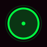
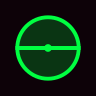
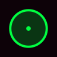
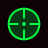
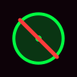

# All States

Full gallery of every state PulseCore ships with its own design for.
Everything not listed here falls back to whatever cursor theme you had
before, via `Inherits=` in `index.theme`.

## Basics

| State | Animation |
|---|---|
| `default` (+ `left_ptr`, `arrow`, `top_left_arrow`, `left_arrow`) |  |
| `pointer` — link hover (+ `hand1`, `hand2`, `hand`, `pointing_hand`) |  |
| `wait` — busy (+ `watch`, `progress`, `left_ptr_watch`) |  |
| `text` — text field (+ `xterm`, `ibeam`) |  |
| `vertical-text` |  |

## Window edges (resize)

| State | Animation |
|---|---|
| `ew-resize` — width (+ `size_hor`, `sb_h_double_arrow`, `h_double_arrow`, `col-resize`) |  |
| `ns-resize` — height (+ `size_ver`, `sb_v_double_arrow`, `v_double_arrow`, `row-resize`, `n-resize`, `s-resize`) |  |
| `nwse-resize` — corner ↖ ↘ (+ `size_fdiag`, `nw-resize`, `se-resize`, `top_left_corner`, `bottom_right_corner`) |  |
| `nesw-resize` — corner ↗ ↙ (+ `size_bdiag`, `ne-resize`, `sw-resize`, `top_right_corner`, `bottom_left_corner`) |  |

## Move & drag

| State | Animation |
|---|---|
| `move` |  |
| `grab` |  |
| `grabbing` |  |
| `not-allowed` (+ `no-drop`) |  |

## Other

| State | Animation |
|---|---|
| `crosshair` (+ `cell`) |  |
| `zoom-in` |  |
| `zoom-out` |  |
| `copy` |  |
| `alias` |  |
| `help` |  |
| `context-menu` |  |

---

Generated with `preview/build_all_states.py` (renders every `frames_*()`
function in `generate.py` at 96px instead of the Xcursor target sizes, for
a crisper README preview).
